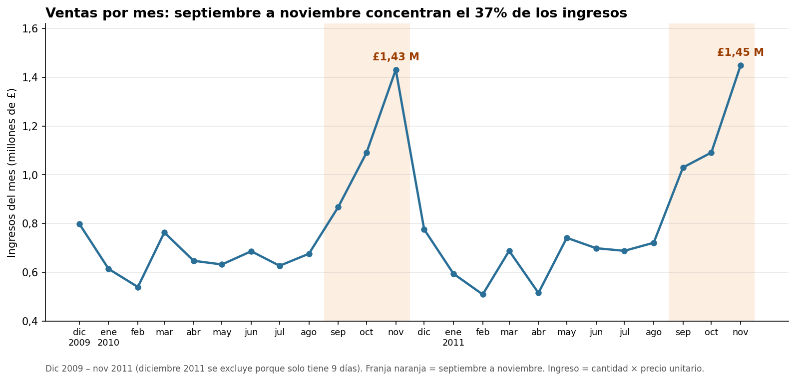
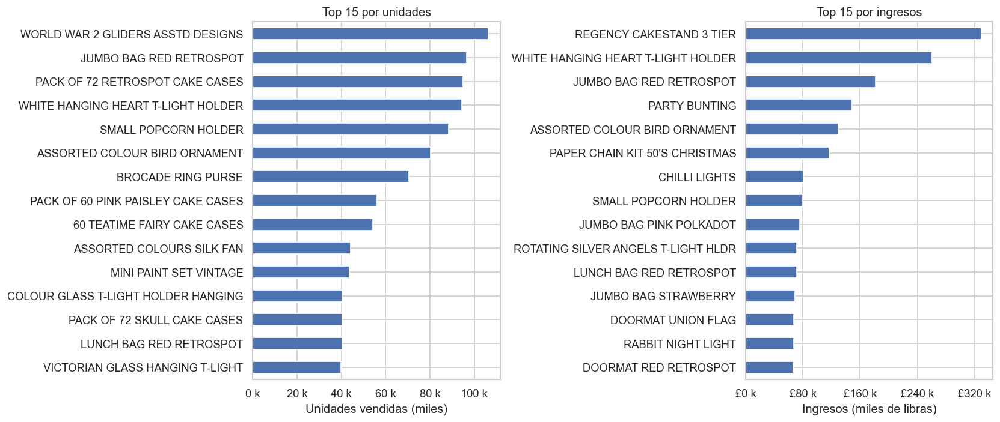
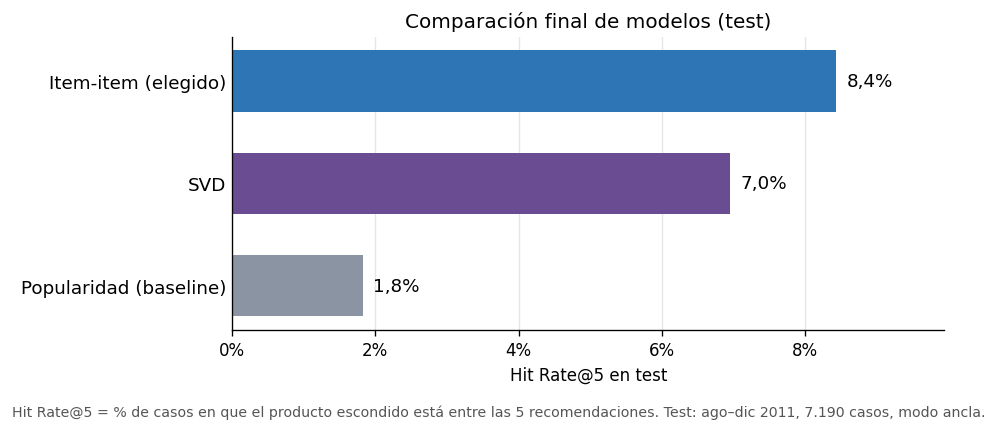

# Asistente de regalos para e-commerce

Proyecto Final Henry · Presente Analytics

Asistente que, a partir de un cuestionario de 5 preguntas, sugiere regalos individuales y combos dentro del presupuesto, usando modelos de recomendación entrenados con compras reales (Online Retail II).

## Índice

- [Equipo y roles](#equipo-y-roles)
- [Cómo correr el proyecto](#cómo-correr-el-proyecto)
- [Estructura del repositorio](#estructura-del-repositorio)
- [1. Calidad de datos](#1-calidad-de-datos)
- [2. Categorías e intereses](#2-categorías-e-intereses)
- [3. EDA y visualizaciones](#3-eda-y-visualizaciones)
- [4. Modelos](#4-modelos)
- [5. Justificación del modelo y plan de validación](#5-justificación-del-modelo-y-plan-de-validación)
- [6. Demo en Streamlit](#6-demo-en-streamlit)
- [7. Pipeline reproducible y monitoreo](#7-pipeline-reproducible-y-monitoreo)
- [Limitaciones](#limitaciones)

## Equipo y roles

Marco Scrum y metodología CRISP-DM. Los roles son formales, para la documentación del PF: todos programamos y aportamos por igual a todo el proyecto.

| Integrante | Rol formal | Aporte adicional | Frente técnico | LinkedIn |
| --- | --- | --- | --- | --- |
| Franco Correa | Product Owner | Visualización y dashboards | Modelado | [](https://www.linkedin.com/in/franco-correa-a6060624a/) |
| Ma Fernanda López Quintana | Scrum Master | Visualización y dashboards | Demo en Streamlit y README | [](https://www.linkedin.com/in/mar%C3%ADa-fernanda-l%C3%B3pez-quintana/) |
| Cristian Durán | Liderazgo técnico (Data Team) | Visualización | EDA y Power BI | [](https://www.linkedin.com/in/cristian-duran-programacion/) |
| Ezequiel Irianni | Liderazgo técnico (Data Team) | Documentación y Git | Modelado | [](https://www.linkedin.com/in/ezequielirianni/) |
| Mauricio Melgarejo | Liderazgo técnico (Data Team) | Documentación y Git | Ingeniería de datos | [](https://www.linkedin.com/in/mauricio-daniel-melgarejo-amaro-482596105/) |

## Cómo correr el proyecto

**Versión de Python:** 3.11 (la misma que usa la CI del repositorio, en `.github/workflows/ci.yml`).

**Instalar dependencias:**

```bash
pip install -r requirements.txt
```

**Generar los datasets limpios** (el Excel original no se sube al repo — colocalo en `data/raw/online_retail_II.xlsx` antes de correr esto):

```bash
python -m src.data.clean
```

Genera `data/processed/online_retail_rfm.parquet` y `data/processed/online_retail_modelo.parquet`.

**Generar las categorías de producto:**

```bash
python -m src.features.build_features
```

   **Generar el catálogo de la app** (necesita el paso anterior):

```bash
   python -m src.data.catalogo_app
```

**Entrenar y evaluar los modelos:** abrir `notebooks/04_modelos.ipynb` y ejecutar todas las celdas (necesita `data/processed/online_retail_modelo.parquet`). Las corridas quedan registradas en MLflow; para verlas, desde la raíz del repo:

```bash
mlflow ui --backend-store-uri sqlite:///mlflow.db
```

**Correr los tests:**

```bash
python -m pytest
```

**Abrir la demo en Streamlit** (local):

```bash
streamlit run app.py
```

La versión publicada está en https://quele-regalo.streamlit.app (ver [6. Demo en Streamlit](#6-demo-en-streamlit)).

## Estructura del repositorio

```
asistente-regalos-ecommerce/
├── .github/
│   └── workflows/
│       └── ci.yml                  # CI: corre los tests en cada PR
├── .streamlit/
│   └── config.toml                 # Configuración visual de la demo
├── assets/
│   └── portada.png                 # Imagen de la demo
├── data/                           # Local, no se sube (ver .gitignore)
│   ├── raw/                        # online_retail_II.xlsx (original)
│   └── processed/                  # Parquets limpios y catálogo
├── models/                         # catalogo_app.parquet, intereses.csv, modelo_final.pkl
├── notebooks/
│   ├── img/                        # Gráficos del análisis de categorías
│   ├── 01_calidad_datos.ipynb      # Limpieza y calidad de datos
│   ├── 02b_categorias.ipynb        # Categorías de producto (TF-IDF + K-Means)
│   ├── 03_eda.ipynb                # Análisis exploratorio
│   └── 04_modelos.ipynb            # Modelos: validación y comparación final
├── reports/
│   ├── figures/                    # Gráficos del EDA (01, 02) y de modelos (04)
│   └── comparacion_modelos.csv     # Tabla final de modelos
├── src/
│   ├── data/
│   │   └── clean.py                # Limpieza → datasets en Parquet
│   ├── features/
│   │   └── build_features.py       # Categorías de producto
│   ├── models/
│   │   ├── train.py                # Matriz y modelos (Popularidad, ItemItem, SVD)
│   │   └── evaluate.py             # Corte temporal, métricas y comparación
│   └── utils/
│       └── mlflow_utils.py         # Registro común de corridas en MLflow
├── tests/
│   ├── test_clean.py
│   ├── test_build_features.py
│   └── test_modelos.py
├── app.py                          # Demo en Streamlit
├── portada-regalos.png             # Portada del README
├── pytest.ini                      # Configuración de los tests
├── requirements.txt                # Dependencias con versiones fijas
├── README_EDA.md                   # Informe ejecutivo del EDA
└── README.md
```

## 1. Calidad de datos

**Dataset:** [Online Retail II](https://archive.ics.uci.edu/dataset/502/online+retail+ii) (UCI, Chen 2012) — 1.067.371 filas, 2009-2011.

**Problemas encontrados y cómo se trataron:**

| Filtro | Filas antes | Filas después | Qué saca |
| --- | --- | --- | --- |
| Solapamiento entre hojas del Excel | 1.067.371 | 1.044.848 | 1.088 facturas de diciembre 2010 duplicadas entre las 2 hojas del archivo original |
| Compras con cancelación exacta | 1.044.848 | 1.043.498 | Compras que en realidad nunca se concretaron: mismo cliente, producto y cantidad que una cancelación dentro de las 6 horas siguientes |
| Cancelaciones | 1.043.498 | 1.024.333 | Facturas que empiezan con "C" |
| Cantidad y precio > 0 | 1.024.333 | 1.018.304 | Incluye ajustes contables (ej. stock_code "B" = deuda incobrable) y pérdidas de depósito ("lost", "damages") |
| Códigos no-producto | 1.018.304 | 1.013.814 | POST, DOT, M, BANK CHARGES, AMAZONFEE, CRUK, B, ADJUST, ADJUST2, D, C2, 23444, 23574, S, TEST001, TEST002 |
| Duplicados | 1.013.814 | 991.648 | Se agrupan y **suman** cantidades (no se descartan filas: evita perder unidades reales) |
| Descripción vacía | 991.648 | 991.648 | — |
| Con cliente identificado (según el dataset de salida) | 991.648 | 764.946 | Solo aplica al dataset de RFM, ver abajo |

**Decisiones clave:**

- **Dos datasets de salida**, no uno: `online_retail_rfm.parquet` (764.946 filas, exige cliente — para RFM y segmentación) y `online_retail_modelo.parquet` (991.648 filas, conserva ventas sin cliente — el modelo de recomendación no necesita saber quién compró).
- **Formato Parquet, no CSV:** en las pruebas de lectura del equipo, CSV no conservó los tipos esperados (`invoice_date` volvió a ser texto y `customer_id` se leyó como `13085.0`). Parquet conserva los tipos de datos.
- **El Excel trae las 2 hojas con un solapamiento real** (1.088 facturas de diciembre 2010 duplicadas entre ambas). Se detecta y saca antes de unirlas, para no contarlas dos veces.
- **Segmentación mayorista/minorista:** percentil 95 de unidades totales compradas por cliente.
- **Códigos `GIFT_` y `PADS` se conservan**, pese a precio cero o casi nulo: tienen descripción de producto real (vales de regalo con monto, "PADS TO MATCH ALL CUSHIONS"), a diferencia de los códigos administrativos excluidos (POST, D, M, etc.), que no describen ningún producto.
- **Facturas "bulk" (posible reposición al por mayor):** marcadas con una columna (`factura_bulk`), no eliminadas del dataset general. La decisión de excluirlas o no del modelo de recomendación se evalúa en Modelado, comparando métricas con y sin ellas.

**Código:** `src/data/clean.py`

**Tests:** `tests/test_clean.py` (14 tests).

**Detalle completo:** `notebooks/01_calidad_datos.ipynb`

Los dos archivos Parquet se generan con `python -m src.data.clean` (ver [Cómo correr el proyecto](#cómo-correr-el-proyecto)). Los datasets no se suben al repositorio.

## 2. Categorías e intereses

### Categorías de producto

Se generan 28 categorías desde `description` (TF-IDF + K-Means), con cada decisión (K, bigramas) comparada en vivo contra alternativas antes de elegirse. No hay un K matemáticamente óptimo: Elbow y Silhouette no marcan un punto de corte claro; se elige por practicidad de formulario.

El 26,6% del catálogo sin vocabulario distintivo queda bajo "Variedad / Sorpresa", considerada una categoría de negocio válida.

**Código:** `src/features/build_features.py`

**Cómo generarlo:** `python -m src.features.build_features` (desde la raíz del repo) — no `python src/features/build_features.py` a secas, porque ese import relativo necesita que Python lo trate como parte del paquete `src`.

**Tests:** `tests/test_build_features.py` (8/8 pasando, según la entrega de categorías).

**Detalle:** `notebooks/02b_categorias.ipynb`

**Salida:** `data/processed/catalogo_categorizado.parquet` (28 categorías, no se sube al repo).

**Modelos congelados:** `data/processed/modelos_categorias.pkl` (no se sube al repo) — vectorizer y K-Means ya entrenados. Productos nuevos se categorizan con `categorizar_productos_nuevos()` sin re-entrenar todo el catálogo, evitando que el número de cada cluster se mueva.

### Intereses del cuestionario

Al revisar los 4.725 productos uno por uno vimos que K-Means agrupa por palabras repetidas (colores, "SET", "DESIGN") y no por tipo de producto: "Sets y combos" mezcla vajilla, velas y tarjetas, y dentro de "Variedad / Sorpresa" hay juguetes, papelería y artículos de jardín. Por eso los intereses del cuestionario no salen de los clusters: cada interés tiene su lista de palabras clave, se evalúan en orden y gana la primera que coincide (con límite de palabra, para que RING no coincida con STRING). Lo que no coincide con ninguna va a "¡Sorprendeme!".

| Interés | Productos | Precio mediano (£) |
|---|---|---|
| Decoración y hogar | 1.172 | 2,89 |
| Cocina y repostería | 825 | 2,55 |
| Accesorios | 717 | 2,95 |
| Papelería y manualidades | 454 | 0,85 |
| Fiestas y celebraciones | 448 | 1,45 |
| Velas y aromas | 431 | 1,95 |
| ¡Sorprendeme! | 254 | 1,67 |
| Niños y juegos | 227 | 2,10 |
| Jardín y flores | 168 | 3,94 |

Se excluyen 29 productos que no corresponden a un asistente de regalos: vales de regalo, ítems que no son producto (una imagen, rellenos de almohadón) y artículos relacionados con drogas o de humor adulto.

**Código:** `src/data/catalogo_app.py` · **Tests:** `tests/test_catalogo_app.py` (22)

**Salida (se sube al repo porque la lee la app):** `models/catalogo_app.parquet` (4.696 productos, 112 KB; columnas `stock_code`, `description`, `price`, `category`, `interes`) y `models/intereses.csv` (tabla interés → categorías principales del catálogo).

## 3. EDA y visualizaciones

Análisis exploratorio completo en [`notebooks/03_eda.ipynb`](notebooks/03_eda.ipynb), con un informe ejecutivo de los hallazgos y lo que implican para el asistente en [`README_EDA.md`](README_EDA.md). Los gráficos están en `reports/figures/`; el dashboard de Power BI queda para la presentación final.

Datos: Online Retail II (diciembre 2009 a diciembre 2011), 991.648 filas y 39.402 facturas. Cifras en libras (£); ingreso = cantidad × precio unitario.

### Gráficos



*Septiembre a noviembre se destacan en los dos años. Diciembre 2011 se excluye porque solo tiene 9 días de datos.*



*Los productos más vendidos por unidades no son los que más facturan: WORLD WAR 2 GLIDERS lidera en unidades (106.331) y REGENCY CAKESTAND 3 TIER en ingresos (£329.342).*

### Tres hallazgos

1. **Las ventas se concentran entre septiembre y noviembre:** esos tres meses suman el **37% de los ingresos** de los dos años (36% y 38% en cada año), y noviembre llega a £1,43 M y £1,45 M, más del doble de un mes típico (£0,68 M) → el asistente tiene en cuenta la época del año y prioriza lo navideño desde septiembre.

2. **Pocos clientes concentran el volumen:** el 5% de los clientes (293) compra el **53,5% de las unidades** → el asistente no puede guiarse solo por lo más comprado en total, y se evalúa recomendar únicamente productos que también compran clientes minoristas.

3. **Productos baratos y pedidos de varios productos:** el producto típico cuesta **£2,10** (3 de cada 4 cuestan £4,25 o menos) y un pedido típico lleva **15 productos distintos** → el asistente trabaja con presupuestos bajos por producto y puede sugerir varios productos (combos) dentro de un mismo presupuesto.


## 4. Modelos

El sistema recomienda productos complementarios a partir de un producto elegido (**ancla**): aprende
qué productos suelen aparecer juntos en una misma factura. Los modelos se entrenan con
`data/processed/online_retail_modelo.parquet`, que conserva las ventas sin cliente porque para
recomendar por co-compra no hace falta saber quién compró.

### Modelos

| Modelo | Archivo | Lógica |
|---|---|---|
| Popularidad (baseline) | `src/models/train.py` | Recomienda los productos que aparecen en más facturas, salvo el ancla |
| Item-item (KNN entre productos) | `src/models/train.py` | Similitud coseno entre productos sobre la matriz binaria factura × producto: recomienda los que más se compran junto con el ancla |
| SVD | `src/models/train.py` | Factorización de la misma matriz; recomienda por similitud entre los factores de cada producto |

La matriz es **binaria** (el producto estuvo o no en la factura): la cantidad comprada no pesa,
para que las compras mayoristas no distorsionen las relaciones entre productos.

### Interfaz común

Cualquier modelo nuevo se puede comparar con los demás si implementa:

- `fit(df_train)`: entrena y devuelve el propio modelo.
- `recomendar(anclas, k)`: devuelve `k` códigos de producto, nunca las anclas.
- `get_params()`: diccionario con su configuración (se registra en MLflow).
- `n_productos`: cantidad de productos que conoce (para la cobertura).

### Cómo se evalúa

1. **Corte temporal** (`corte_temporal`): el 80% más antiguo de las facturas es desarrollo y el 20%
   más reciente es test. Ninguna factura queda partida.
2. **Validación cruzada temporal** (`evaluar_cv_temporal`) dentro del desarrollo, con folds expansivos
   (siempre se entrena con el pasado y se valida con el período siguiente), para elegir parámetros
   sin mirar el test.
3. Los modelos elegidos se **reentrenan con todo el desarrollo**.
4. **Comparación final** (`comparar_modelos`) sobre el test, **una sola vez**.

En cada factura de evaluación con 2 o más productos se esconde uno al azar (semilla fija) y se mide
si el modelo lo recupera:

- **Modo ancla (principal):** el modelo ve un solo producto de la factura, igual que en el asistente,
  donde el usuario elige un producto de referencia. Con este modo se eligen los parámetros y el modelo.
- **Modo carrito (referencia):** el modelo ve todos los demás productos de la factura. Es la formulación
  de la propuesta y la base de `armar_combos` (Sprint 2); se reporta al lado, sin usarse para elegir.

| Métrica | Qué mide |
|---|---|
| Hit Rate@5 (KPI principal) | Porcentaje de casos en que el producto escondido está entre las 5 recomendaciones |
| NDCG@5 | Igual, pero premia que el acierto esté más arriba en la lista |
| Cobertura de catálogo | Porcentaje de productos que el modelo llega a recomendar alguna vez |

### MLflow

Todas las corridas se registran con `registrar_corrida()` (`src/utils/mlflow_utils.py`), igual que
el resto del equipo: un solo experimento, `asistente-regalos-ecommerce`, con la base `mlflow.db` y
los artefactos en `mlartifacts/`, ambos en la raíz del repo (sin importar desde qué carpeta se
ejecute). Las etapas se separan con el tag `etapa`:

- `validacion`: una corrida por configuración probada (`evaluar_cv_temporal(..., registrar_mlflow=True)`),
  con la media y el desvío entre folds. Es la justificación con números de cada parámetro elegido.
- `test_final`: una corrida por modelo en la comparación final (`comparar_modelos`), con el modelo
  entrenado guardado como artefacto, y una corrida de resumen con la tabla y el gráfico.

Cada corrida lleva además el tag `familia` (popularidad, item_item, svd).
Para verlas, desde la raíz: `mlflow ui --backend-store-uri sqlite:///mlflow.db` y filtrar, por
ejemplo, con `tags.etapa = "validacion"`. `mlflow.db` y `mlartifacts/` no se suben al repo: las
corridas se regeneran ejecutando el notebook.

### Notebook

`notebooks/04_modelos.ipynb` reúne todo el modelado: corte temporal, casos de prueba, los tres
modelos, validación cruzada temporal de 11 configuraciones, reentrenamiento de las elegidas y
comparación final sobre el test.

**Tests:** `tests/test_modelos.py` (32 tests: corte y folds temporales, métricas, casos, matriz,
los tres modelos, filtros de entrenamiento y el registro en MLflow con una base temporal). La CI los corre en cada PR; a mano,
desde la raíz: `python -m pytest tests/ -v`.

### Resultados (test, modo ancla)

Test: agosto a diciembre de 2011 (7.190 casos), un período que ningún modelo vio al entrenar.

| Modelo | Configuración | Hit Rate@5 | NDCG@5 | Cobertura | Hit Rate@5 carrito (ref.) |
|---|---|---|---|---|---|
| **Item-item** | min_facturas=5, tope 200 productos por factura | **8,4%** | **0,059** | **61,6%** | **19,9%** |
| SVD | 50 componentes, tope 200 | 7,0% | 0,048 | 53,5% | 7,0% |
| Popularidad (baseline) | criterio "facturas" | 1,8% | 0,011 | 0,1% | 2,3% |

Cobertura = productos distintos que el modelo recomendó alguna vez, sobre los 4.456 productos que existen en el período de desarrollo (no sobre los 4.725 del dataset completo).



## 5. Justificación del modelo y plan de validación

### Plan de validación

1. **Test reservado desde el principio:** el 20% más reciente de las facturas (19/08/2011 al 09/12/2011)
   se separa antes de cualquier prueba y se usa **una sola vez**, al final. Así la cifra que se reporta
   no está influida por la elección de parámetros.
2. **Validación cruzada temporal** sobre el 80% restante: 3 folds expansivos, siempre entrenando con el
   pasado y validando con el período siguiente. Ahí se comparan 11 configuraciones y se eligen los
   parámetros de cada modelo. El desvío entre folds se usa como referencia descriptiva de variabilidad, no como una
   prueba de significancia estadística. El notebook selecciona automáticamente el mayor Hit Rate medio
   de cada familia; permite ajustar manualmente la selección para priorizar simplicidad.
3. **Reentrenamiento** de las configuraciones elegidas con todo el desarrollo y **comparación final**
   sobre el test, con los mismos casos para los tres modelos.
4. **Modo ancla como principal** (el modelo ve un producto, como en el asistente) y modo carrito como
   referencia (ve todos los demás productos de la factura).
5. Todas las corridas quedan en MLflow (`etapa = validacion` y `etapa = test_final`), con parámetros y métricas.

### Por qué item-item

Criterios, en este orden: Hit Rate@5 en test, NDCG@5 para desempatar, cobertura del catálogo y explicabilidad.

1. **Hit Rate@5:** 8,4% en test, más de 4 veces el baseline (1,8%) y por encima del SVD (7,0%).
   El orden es el mismo en la validación (9,4% / 7,7% / 3,2%), lo que respalda la elección en los períodos evaluados, sin garantizar el resultado en períodos futuros.
2. **NDCG@5:** también el mejor (0,059): cuando acierta, el producto aparece más arriba.
3. **Cobertura:** recomienda el 61,6% del catálogo conocido en desarrollo, contra el 53,5% del SVD y el 0,1% del baseline.
4. **Explicabilidad:** se explica en una frase ("otros clientes lo compraron junto con este"), lo que
   permite mostrarle al usuario por qué se le sugiere cada regalo.
5. **Modo carrito:** con varios productos a la vista llega al 19,9%, casi el triple que el SVD. Es la
   base de `armar_combos` (Sprint 2).

**Parámetros elegidos** (validación cruzada, ver `notebooks/04_modelos.ipynb`):

- `min_facturas = 5`: con 3, 5 y 10 el Hit Rate medio es similar (9,0%–9,1%); con 10 baja la cobertura.
  La búsqueda de este umbral se hizo en item-item; en SVD se mantuvo el valor 5 por defecto.
- Facturas bulk **no se excluyen**: excluirlas no cambia el Hit Rate y baja un poco la cobertura.
- `max_productos_factura = 200`: se ignoran al construir la matriz de item-item y SVD las facturas de más de 200 productos distintos
  (reposiciones de medio catálogo). La mejora es chica, pero se repite en el item-item y en el SVD y sube la cobertura.
- SVD con 50 componentes: sin tope, 100 mejora levemente el Hit Rate medio (7,5% frente a
  7,4%), con una diferencia menor que el desvío entre folds; con 20 baja a 6,7%. La configuración
  elegida combina 50 componentes y tope 200 (7,7%). El SVD queda documentado como
  alternativa: encuentra relaciones indirectas, pero no supera al item-item en las métricas de la comparación final.
- Ambos modelos completan con popularidad cuando faltan recomendaciones; ese respaldo se entrena
  con todo el desarrollo, sin aplicar el tope de 200 productos.

**Limitaciones:** aprende de compras (feedback implícito), no de satisfacción; los datos son de 2009-2011;
las métricas son offline y el efecto real sobre las ventas se mediría con un test A/B. Solo se
evalúan facturas con al menos dos productos conocidos en desarrollo (7.190 casos de 7.881 facturas
de test); estos resultados no miden la recomendación de productos nuevos. Los productos se identifican
por `stock_code`; la descripción se usa para mostrarlos al usuario.

El test cubre parte de la temporada previa a Navidad de 2011, hasta el 9 de diciembre. Los tres modelos
tienen menor Hit Rate@5 que en validación; el baseline cae de 3,2% a 1,8%. La estacionalidad es una
posible explicación, pero estas métricas por sí solas no demuestran la causa de la caída.

## 6. Demo en Streamlit

Se desarrolló y desplegó una primera versión funcional de la interfaz del
Asistente de Regalos en Streamlit.

🎁 **Demo pública:** https://quele-regalo.streamlit.app

Actualmente, la aplicación permite completar las preferencias del usuario,
seleccionar un rango de presupuesto y visualizar la experiencia propuesta.

La integración con el catálogo de productos y el modelo de recomendación
se incorporará en la siguiente etapa del proyecto.

## 7. Pipeline reproducible y monitoreo

El proyecto se puede reproducir y revisar gracias a dos piezas: los tests corren solos en cada Pull Request (GitHub Actions) y todos los experimentos de modelado quedan registrados en un mismo lugar (MLflow).

### 7.1 Integración continua (GitHub Actions)

El workflow `.github/workflows/ci.yml` se ejecuta en cada Pull Request contra `main` y en cada push a `main`, sobre una máquina limpia de GitHub (Ubuntu):

| Paso | Qué hace |
|---|---|
| Clonar el repo | Descarga el código de la rama del PR |
| Configurar Python 3.11 | La misma versión indicada en "Cómo correr el proyecto" |
| Instalar dependencias | `pip install -r requirements.txt` |
| Correr los tests | `pytest tests/ -v` |

El resultado (verde o rojo) aparece en el PR antes de que alguien lo apruebe. Hoy corren 76 tests:

| Archivo | Tests | Qué cubren |
|---|---|---|
| `tests/test_clean.py` | 14 | Filtros de limpieza, segmentación de clientes, facturas bulk, catálogo y cuatro bugs encontrados en la revisión (solapamiento entre hojas del Excel, cancelaciones, clientes anónimos, códigos no-producto) |
| `tests/test_build_features.py` | 8 | Clustering de productos y asignación de las categorías |
| `tests/test_catalogo_app.py` | 22 | Reglas de intereses, exclusiones y que el catálogo de la app no tenga productos sin precio o categoría |
| `tests/test_modelos.py` | 32 | Corte temporal y folds, métricas, los tres modelos y el registro en MLflow |

Decisiones tomadas:

- **`requirements.txt` con versiones fijas de las dependencias directas, no `pip freeze`.** El freeze incluía paquetes que solo existen en Windows (`pywin32`) o que piden otra versión de Python, y la CI fallaba en Ubuntu.
- **`pytest.ini` con `pythonpath = .`**, para que `from src...` funcione igual en la CI que en cada máquina, sin modificar `sys.path` dentro de los tests.
- **Los tests no usan el dataset real**, que no está en el repo: cada test arma un DataFrame chico con el caso que quiere probar.
- **Los tests de MLflow escriben en una base temporal**, para no mezclarse con las corridas reales del equipo.

### 7.2 Registro de experimentos (MLflow)

`src/utils/mlflow_utils.py` tiene una sola función, `registrar_corrida()`, que usa todo el equipo para registrar parámetros, métricas y, opcionalmente, el modelo entrenado. Así todas las corridas quedan en el mismo experimento y se pueden comparar.

- **Experimento:** `asistente-regalos-ecommerce`.
- **Dónde se guarda:** `mlflow.db` (base SQLite) y `mlartifacts/`, en la raíz del repo sin importar desde qué carpeta se ejecute: la ruta se calcula a partir de la ubicación del archivo, así un notebook y un script escriben en la misma base.
- **Modelos guardados con `joblib`:** nuestros modelos no son estimadores de scikit-learn, y así se puede guardar cualquier objeto.
- **No se suben al repo** (están en `.gitignore`): las corridas se regeneran ejecutando el notebook.
- **Etapas, con el tag `etapa`:** `validacion` y `test_final` (detalle en la sección 4, MLflow) y `monitoreo`, reservada para la reevaluación del modelo (7.3).

Para verlas: `mlflow ui --backend-store-uri sqlite:///mlflow.db`, abrir http://127.0.0.1:5000 y elegir la vista **Model training**.

### 7.3 Monitoreo

Próximo paso (Sprint 2): un script que reevalúe el modelo elegido sobre períodos nuevos con la misma función `evaluar()` de `src/models/evaluate.py` y registre cada resultado en MLflow con `etapa="monitoreo"`. La sección 5 muestra por qué hace falta: el Hit Rate@5 de item-item baja de 9,4% en validación a 8,4% en test, así que el rendimiento no está garantizado en períodos futuros.

## Limitaciones

Pendiente de completar: qué no cubre este prototipo.
