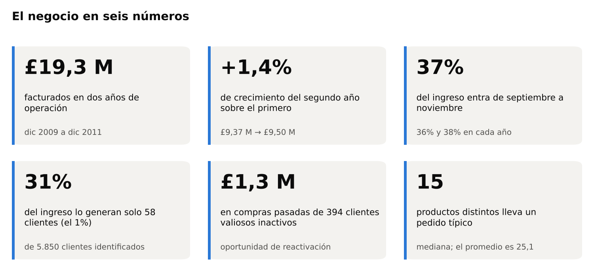
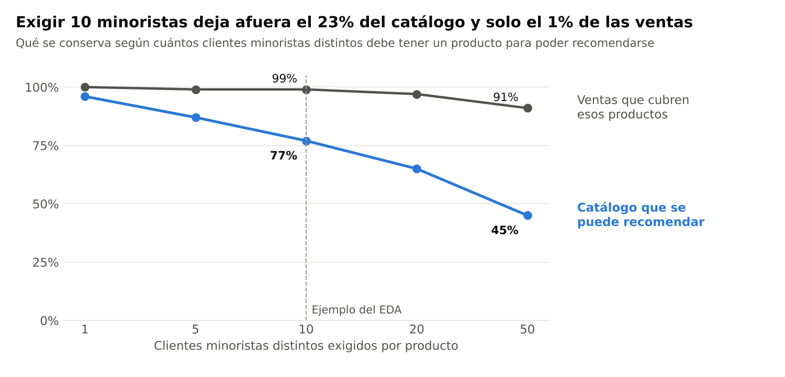
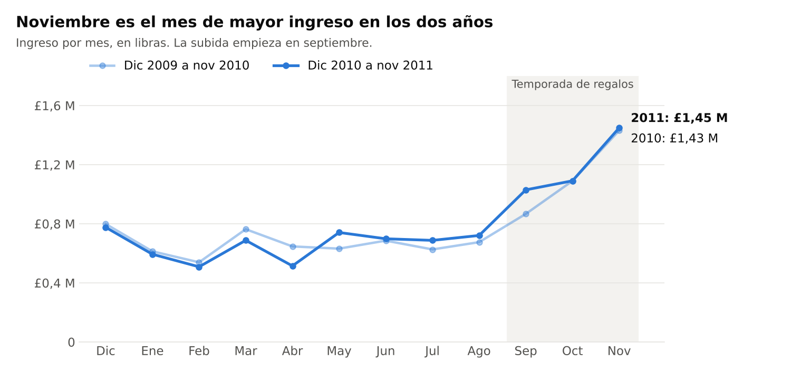
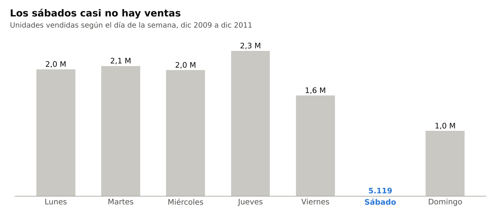
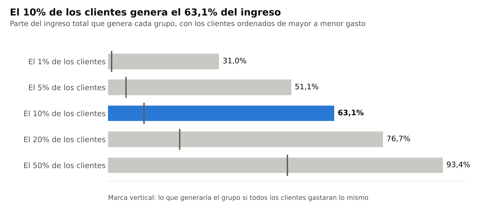
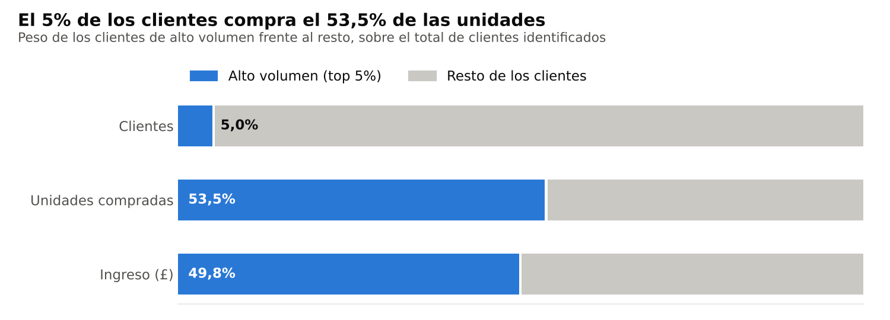
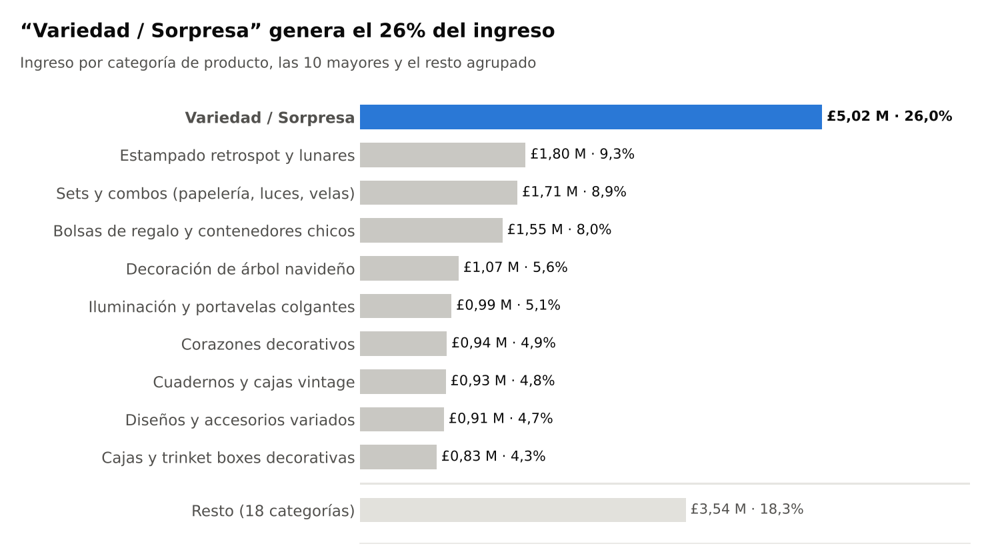
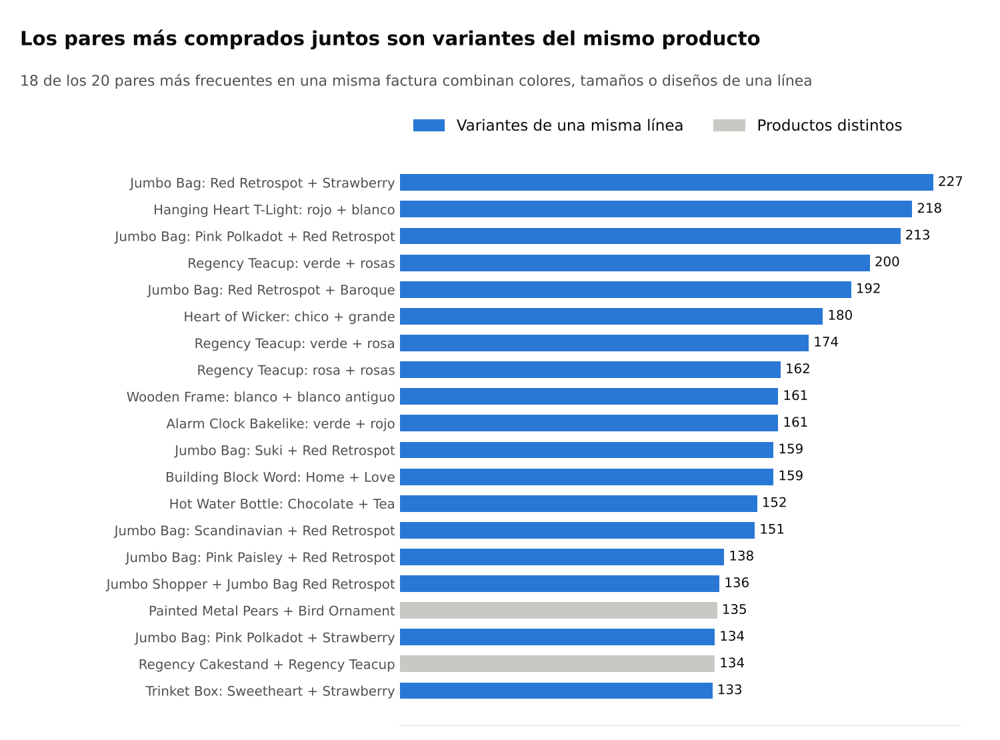

# Informe ejecutivo — Hallazgos del análisis exploratorio

Asistente de regalos para e-commerce · Presente Analytics · Mauricio Melgarejo · octubre 2026

Este informe resume los hallazgos del análisis exploratorio y qué decisiones implican para el diseño del asistente. El detalle técnico está en [`notebooks/03_eda.ipynb`](notebooks/03_eda.ipynb).

## Índice

- [1. Resumen ejecutivo](#1-resumen-ejecutivo)
- [2. Qué implica para el asistente](#2-qué-implica-para-el-asistente)
- [3. Decisiones pendientes del Sprint 2](#3-decisiones-pendientes-del-sprint-2)
- [4. Evidencia: cuándo se compra](#4-evidencia-cuándo-se-compra)
- [5. Evidencia: quién compra y qué se compra](#5-evidencia-quién-compra-y-qué-se-compra)
- [6. Datos, limitaciones y fuentes](#6-datos-limitaciones-y-fuentes)

## 1. Resumen ejecutivo

Una tienda online de regalos que factura unos £9,5 M por año, con un ingreso estable que crece solo en la temporada de fiestas, y que depende de un grupo chico de clientes identificados.

- **La venta depende de la temporada.** Septiembre a noviembre concentra el 37% del ingreso, y noviembre es el mes más fuerte en los dos años.
- **El ingreso está concentrado.** Entre los clientes identificados, el 10% genera el 63,1% del ingreso, y el 5% de mayor volumen compra el 53,5% de las unidades.
- **"Lo más vendido" cambia según cómo se mida.** El producto líder en unidades no es el líder en ingresos.
- **La señal más clara para recomendar:** quien compra un producto suele llevarse otras variantes de la misma línea (otros colores o estampados).
- **Los datos pasaron por una depuración explícita.** La limpieza aplica reglas documentadas y controladas con tests automáticos; siguen existiendo las limitaciones propias de la fuente y del período analizado (ver [sección 6](#6-datos-limitaciones-y-fuentes)).

## 2. Qué implica para el asistente

La tabla separa lo que muestran los datos, lo que el equipo propone hacer con eso y lo que todavía falta comprobar.

| Lo que muestran los datos | Lo que proponemos | Qué falta validar |
| --- | --- | --- |
| Noviembre concentra la venta y la categoría navideña crece desde septiembre | Que lo navideño gane peso en las recomendaciones a partir de septiembre | Si ponderar por época mejora las recomendaciones en la evaluación |
| Los pares más comprados juntos son variantes de una misma línea | Sugerir otras variantes del producto elegido y usarlas para armar combos | Cuánta variedad necesita un combo para no repetir el mismo producto en otro color |
| El líder cambia según se mida por unidades, ingresos o presencia en facturas | Medir la popularidad por presencia en facturas, la medida que eligió el equipo | Ya comprobado en el EDA: con esa medida, sacar las facturas bulk no cambia el top 15 |
| El 5% de los clientes identificados compra el 53,5% de las unidades | Entrenar con todas las compras, pero recomendar solo productos que compraron varios clientes minoristas distintos | Es una hipótesis de diseño: falta elegir el umbral y medir su efecto en las recomendaciones |
| "Variedad / Sorpresa" agrupa el 26,6% de los productos y genera el 26,0% del ingreso | Refinar esa categoría antes de usarla para filtrar por intereses | Cuántos productos se pueden reasignar a una categoría con tema |
| El 75% del catálogo cuesta £4,25 o menos | Armar combos de varios productos dentro del presupuesto | Cuántos productos y combos entran en presupuestos de £20, £50 y £100 |

El filtro de clientes minoristas parece tener un costo bajo: si se exige que al menos 10 minoristas distintos hayan comprado el producto, queda afuera el 23% del catálogo, pero solo el 1% de las ventas.

Fuente: notebook 03, sección B.8.3 · 4.725 productos.

## 3. Decisiones pendientes del Sprint 2

Cuatro decisiones condicionan lo que recomienda el asistente. Cada una tiene un criterio para tomarla y un resultado esperado.

| Decisión | Frente | Cómo se decide | Resultado esperado |
| --- | --- | --- | --- |
| Umbral de clientes minoristas por producto | Modelado | Comparar umbrales de 1, 5, 10, 20 y 50 minoristas: productos disponibles, ventas cubiertas y Hit Rate@5 | Un umbral que saque productos de nicho mayorista sin perder cobertura del catálogo |
| Precio mínimo para recomendar | Modelado | Revisar los productos de precio casi nulo que pasan el filtro (por ejemplo, PADS TO MATCH ALL CUSHIONS, a £0,001) | Un piso de precio por debajo del cual un producto no se ofrece como regalo |
| Precios anómalos | Datos | Revisar las 754 líneas (0,08% del total) con precio diez veces mayor al habitual y sin cliente, que parecen ajustes administrativos | Excluirlas o conservarlas, con el criterio documentado y un test |
| Refinar "Variedad / Sorpresa" y medir presupuestos | Categorías | Reagrupar sus productos y contar cuántos productos y combos entran en £20, £50 y £100 | Menos productos sin tema y una lista de intereses usable en el cuestionario |

## 4. Evidencia: cuándo se compra

La compra de regalos se adelanta a las fiestas: noviembre es el mes de mayor venta en los dos años, y la subida empieza en septiembre.

Fuente: notebook 03, sección B.1 · 24 meses completos, dic 2009 a nov 2011.

**El crecimiento está solo en la temporada.** Comparando los dos períodos de 12 meses completos, el ingreso total crece 1,4%, pero ese crecimiento viene entero de septiembre a noviembre; el resto del año queda prácticamente igual.

| Período | Dic 2009 a nov 2010 | Dic 2010 a nov 2011 | Variación |
| --- | --- | --- | --- |
| Diciembre a agosto | £5.981.422 | £5.929.699 | −0,9% |
| Septiembre a noviembre | £3.387.895 | £3.569.249 | +5,4% |
| **Total 12 meses** | **£9.369.317** | **£9.498.948** | **+1,4%** |

Fuente: suma de los ingresos mensuales del notebook 03, sección B.1. Diciembre de 2011 queda afuera porque solo tiene 9 días.

- **Noviembre:** 745.545 unidades y £1,45 M de ingreso en 2011; 724.991 unidades y £1,43 M en 2010. El mismo pico en los dos años indica un patrón estable, no un evento aislado.
- **Febrero** es el mes más flojo: vende menos de la mitad que noviembre.
- **La categoría navideña acompaña el pico.** "Decoración de árbol navideño" es la categoría con la estacionalidad más marcada: entre enero y agosto vende de 27.079 a 48.954 unidades por mes, y en noviembre llega a 147.240 (sumando los dos años). La suba ya se nota en septiembre, cuando también aumentan los clientes nuevos (238 en septiembre y 374 en octubre de 2010; 188 y 222 en 2011).
- **Días y horarios:** las ventas se concentran entre las 10 y las 15 horas, con el máximo a las 12. Los sábados casi no hay actividad (5.119 unidades en todo el período).

Fuente: notebook 03, sección B.2 · todas las ventas, dic 2009 a dic 2011.

El jueves es el día de más venta y el domingo vende la mitad que un día de semana. Para el asistente, el día de la semana pesa menos que la época del año.

## 5. Evidencia: quién compra y qué se compra

### Quién compra

Los datos de clientes se refieren a los **5.850 clientes identificados**; casi una de cada cuatro ventas no tiene cliente asociado y queda fuera de este análisis.

Fuente: notebook 03, sección B.7 · 5.850 clientes identificados.

- **Clientes de alto volumen:** 293 clientes (el 5% de los identificados) compran el 53,5% de las unidades y generan casi lo mismo que los otros 5.557 juntos (£8,33 M contra £8,41 M). El cliente mediano de este grupo gasta £14.070; el resto, £788. Un volumen alto no demuestra que sean mayoristas o revendedores: el grupo se define con una regla del equipo (percentil 95 de unidades compradas).
- **Los mejores clientes:** el segmento que compra seguido, compró hace poco y gasta mucho (RFM 555) son 463 clientes, el 7,9% del total, y reúnen el 47,6% del ingreso.
- **Clientes valiosos inactivos:** 394 clientes que gastaron mucho llevan tiempo sin comprar. Suman £1,3 M en compras históricas y son candidatos a una campaña de reactivación.

Fuente: notebook 03, sección B.7 · 5.850 clientes identificados.

Si el modelo aprende sin cuidado, puede recomendar lo que este grupo compra en volumen, que no necesariamente es lo que elige alguien que busca un regalo. Por eso la propuesta de filtrar por clientes minoristas, que todavía hay que validar (sección 3).

### Qué se compra

El catálogo es mayormente de regalos económicos, y el producto "más vendido" depende de la medida que se use.

| Medida | Producto líder | Valor |
| --- | --- | --- |
| Unidades vendidas | WORLD WAR 2 GLIDERS | 106.331 unidades |
| Ingresos | REGENCY CAKESTAND 3 TIER | £329.342 |
| Presencia en facturas (la medida del equipo) | Bolsas de uso cotidiano | 8 de los 15 primeros |

- **Precios:** el precio mediano de un producto es £2,10 y el 75% del catálogo cuesta £4,25 o menos. Los más caros son muebles, de hasta £295.
- **Tamaño de las facturas:** la mediana es de 15 productos distintos por factura y £301,72 de gasto; los promedios son mayores (25,1 productos y £490,20) porque hay un grupo de compras muy grandes. Se usa la mediana porque describe mejor una compra habitual. Que una factura típica tenga varios productos respalda que el asistente sugiera combos y no solo regalos sueltos.
- **Identificar productos por código, no por nombre:** el 23,93% de las ventas corresponde a productos que cambiaron de nombre en algún momento, así que el análisis usa siempre el código de producto.
- **Categorías:** el catálogo quedó organizado en 28 categorías (ver [sección 2 del README](README.md#2-categorías-e-intereses)). "Variedad / Sorpresa" reúne dos medidas distintas que conviene no confundir: agrupa el **26,6% de los productos** del catálogo y genera el **26,0% del ingreso**.

Fuente: notebook 03, sección B.9 · 28 categorías, ingreso total £19,31 M.

El dato económico es el que justifica priorizarla: una de cada cuatro libras sale de productos sin un tema claro. Refinar esa categoría es la mejora con más impacto para que el filtro por intereses funcione.

Fuente: notebook 03, sección B.10 · facturas de 2 a 15 productos distintos; clasificación de los pares por nombre del producto.

Esta es la señal más directa para el recomendador: quien elige un producto suele llevarse otra versión de la misma línea. Ofrecer esas variantes antes que productos de otras categorías es una primera regla simple, respaldada por los datos, que el modelo item-item ya captura.

## 6. Datos, limitaciones y fuentes

### Qué datos analizamos

Analizamos 39.402 facturas de una tienda online del Reino Unido que vende artículos de regalo y decoración, entre el 1 de diciembre de 2009 y el 9 de diciembre de 2011. Son compras reales, publicadas por la UCI ([Online Retail II](https://archive.ics.uci.edu/dataset/502/online+retail+ii)). El período cubre dos temporadas completas de fiestas, 4.725 productos y clientes de 43 países. Diciembre de 2011 trae solo 9 días, así que queda fuera de las comparaciones entre meses.

Del archivo original se eliminó o consolidó el 7,09% de las filas: facturas repetidas entre las dos hojas del Excel, cancelaciones, movimientos contables que no son productos y líneas duplicadas. Cada regla está documentada en la [sección 1 del README](README.md#1-calidad-de-datos) y cubierta por tests automáticos. Casi una de cada cuatro ventas no tiene cliente identificado (el 98,8% de ellas son del Reino Unido); esas ventas se usan para saber qué se vende, pero no para estudiar clientes.

### Cómo leer estos resultados

Los hallazgos describen lo que pasó en esta tienda entre 2009 y 2011; no prueban causas ni representan necesariamente el mercado actual.

- **Sábados:** la falta de ventas ese día no demuestra que el negocio venda solo a empresas.
- **Clientes de alto volumen:** "top 5%" es una medida estadística, no la confirmación de que esos clientes revendan.
- **Clientes inactivos:** el dataset termina el 9 de diciembre de 2011, así que no se puede afirmar que se hayan ido.
- **Frecuencia y gasto:** van juntos (correlación de 0,63), pero eso no dice que comprar más seguido cause un mayor gasto.
- **Segmentos RFM:** son posiciones relativas dentro de esta cartera de clientes, no umbrales que sirvan para otra tienda.

### Fuentes

- Notebook del EDA del equipo: [`notebooks/03_eda.ipynb`](notebooks/03_eda.ipynb).
- Limpieza de datos: [`src/data/clean.py`](src/data/clean.py) y [sección 1 del README](README.md#1-calidad-de-datos).
- Dataset: [Online Retail II, UCI Machine Learning Repository](https://archive.ics.uci.edu/dataset/502/online+retail+ii) (Chen, 2012).
- Gráficos: `reports/figures/informe_*.png`, generados a partir de las cifras del notebook.
